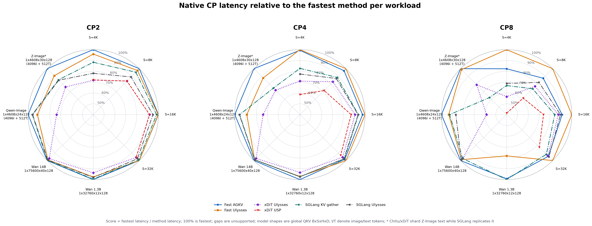

# Fast CP

Fast CP 通过序列并行降低 DiT attention 的多卡推理延迟。优化集中在三个方面：减少 GPU 间通信的中间拷贝，提高分片后 attention 的计算利用率，以及让数据搬运与投影计算重叠。

## 并行方式

**AGKV** 按序列划分 Q/K/V。每张 GPU 保留本地 Q，收集全局 K/V 后计算本地输出。它不切分 attention heads，因此不会因 head 数与并行度不匹配而增加计算。

**Ulysses** 通过两次 all-to-all，在 attention 前后交换序列与 head 的分片维度。计算时，每张 GPU 处理完整序列和部分 heads。当 head 数不能被并行度整除时，需要补齐 heads，增加通信与计算量。

两种方式保持相同的 attention 语义，性能取决于序列长度、head 数、并行度和 GPU 互连。

## 三层优化

1. **GPU 间数据搬运。** 使用 NVSHMEM 对称内存，让发送端直接写入接收端需要的布局，减少中间缓冲、内存重排和额外拷贝。投影结果也可直接写入通信槽位，缩短数据从计算到发送的路径。
2. **Attention 计算。** Attention Planner 根据张量形状、GPU 和并行度选择计算后端与分块方案。短序列切分后，任务数量可能不足以充分利用所有 SM；Planner 对尾部任务沿 K/V 维拆分，增加可并行工作，再用 FP32 输出和归一化统计量合并结果。拆分与合并也有成本，因此只在适合的形状上采用。
3. **GPU 内数据搬运与重叠。** 根据负载选择 SM、TMA 或 Copy Engine（CE）搬运，并调整多流调度。CE 不占用计算 SM，可将 K/V 发送与 Q 投影、归一化和位置编码重叠。Ulysses 分别选择输入和输出方向的搬运方式；AGKV 根据模型结构选择融合投影或通信重叠。

融合与重叠各有代价：融合投影减少小 GEMM 和中间访存，分开投影则能更早发送 K/V。Fast CP 在准备阶段选择执行方案，避免在每次推理中重新调优。减少拷贝能降低数据搬运成本，但端到端收益仍取决于这部分是否位于执行的关键路径。

## 模型支持

当前模型适配覆盖从 QKV 投影到输出投影的完整 attention block，均支持 AGKV 和 Ulysses。

| 模型 | AGKV 执行方式 | 验证负载 |
| --- | --- | --- |
| Wan 2.1 T2V 1.3B / 14B | K/V 发送与 Q 投影重叠 | 1.3B：S32760/H12；14B：S75600/H40 |
| Qwen-Image | 图文序列分片，准备时选择融合 QKV 投影或 CE 重叠 | 图像 4096 + 文本 512，H24 |
| Z-Image | 支持文本分片或复制，使用 CE 重叠 | 图像 4096 + 文本 512，H30 |

Ulysses 使用串行通信与 attention，保留 Planner 和搬运方式选择。完整模型适配需要显式接入；现有命令行的 Fast transport 开关只选择通信后端。其他模型尚未提供完整 wrapper adapter，其已有的 Fast transport 支持不受影响。

## 性能

以下测试使用单节点 H20 NVLink，固定 B1/H40/D128、BF16、非 causal attention。计时从已投影的本地 Q/K/V 到本地输出，包含通信和 attention，不包含输入、输出投影。加速比相对于相同形状的单卡 Chitu attention。

| 全局序列长度 | Fast AGKV CP2 | CP4 | CP8 | Fast Ulysses CP2 | CP4 | CP8 |
| ---: | ---: | ---: | ---: | ---: | ---: | ---: |
| 4096 | 1.78x | 2.90x | 4.05x | 1.71x | 2.91x | 4.92x |
| 8192 | 1.87x | 3.37x | 5.55x | 1.83x | 3.46x | 6.33x |
| 16384 | 1.95x | 3.68x | 6.63x | 1.95x | 3.77x | 7.28x |
| 32768 | 1.96x | 3.81x | 7.22x | 1.96x | 3.88x | 7.65x |

短序列下，通信、同步和 kernel 启动开销限制了扩展效率。随着序列增长，attention 的计算量以平方增长，通信占比下降，多卡加速更接近线性。

下图同时比较共享 attention 和模型 attention block。每个顶点以该负载的最低延迟归一化，100% 表示最快。模型 block 包含投影、归一化和位置编码，使用前述模型支持表中的实际形状。

模型测试使用随机权重，不包含完整去噪流程、文本编码器和 VAE，不能直接解释为完整生成任务的加速。图表保留对应测量版本，不将后续局部优化的收益叠加到已有结果中。测量方法、框架差异和消融结果见[基准报告](https://github.com/thu-pacman/ChituDiffusion/blob/kernels/tools/benchmarks/fast_cp_frameworks/RESULTS.md)，原始数值见[结果数据](../assets/fast_cp/README.md)。

## 接入与适用范围

模型 adapter 描述归一化、位置编码和文本分片语义，公共运行时负责通信内存、执行计划和资源管理。准备过程由所有 rank 共同完成；同形状的模型层复用通信槽位，避免通信内存随层数增长。普通调用支持输入地址变化；固定地址调用可进一步省去输入暂存和输出复制，但输出需要在下一次调用前使用或另行保存。

完整 wrapper 已验证 H20 NVLink、CP2/4/8、TP1、B1、BF16、D128、等长序列分片，以及无 mask 的非 causal MHA。目前不支持外层 CUDA Graph 捕获或并发 stream 执行。SM120 支持基础通信扩展构建，完整模型路径仍需单独验证和性能校准；多机通信使用 NCCL。

新环境按[安装与启用指南](../usage/fast-cp-installation.md)完成依赖、扩展构建和多卡检查。具体接口、输入约定和资源生命周期见[接入说明](https://github.com/thu-pacman/ChituDiffusion/blob/kernels/chitu_diffusion/parallel/cp/fast/README.md)。干净环境的完整构建与 GPU 验收仍待完成。
