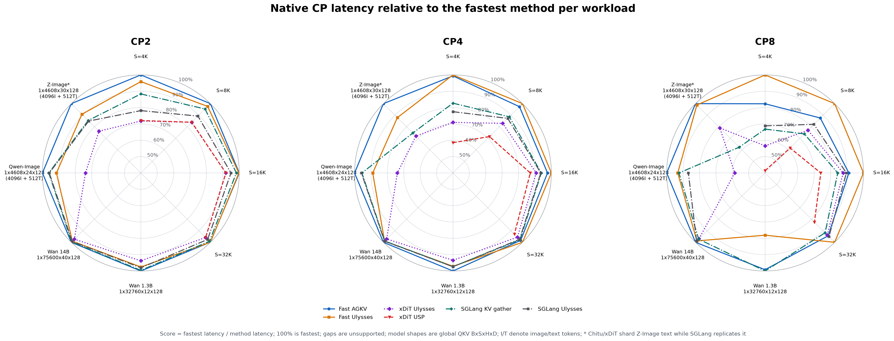

# Fast CP 基准测试结果

本文汇总 Fast AGKV、Fast Ulysses、xDiT 和 SGLang Diffusion 在 NVIDIA H20
上的最新测试结果。结果分为两个边界：共享 CP attention 单元测试用于比较通信和
attention 实现；模型 attention block 测试用于比较各仓库在真实模型 shape 下的原生
路径。两类结果不能直接混用。

## 主要结论

- 在 `B=1, H=40, D=128` 的共享 CP attention 测试中，Fast AGKV 或 Fast
  Ulysses 在全部 12 个 `序列长度 x CP degree` 组合中取得最低延迟。
- Fast Ulysses 的 CP8 单卡加速比随序列长度从 `4.92x` 提升到 `7.65x`。短序列下，
  通信、同步、kernel launch 和 attention 尾部 wave 占比更高；长序列下，二次增长的
  attention 计算占主导，因此更接近线性扩展。
- 在真实 Wan shape 下，Fast AGKV 的表现最稳定：Wan 1.3B 的 CP8 延迟为
  `7.276 ms`，Wan 14B 为 `119.371 ms`。后者是全部可用原生实现中的最低值。
- Qwen-Image 融合 QKV epilogue/layout 并自动选择 projection 调度后，Fast AGKV
  在 CP2/4/8 分别为 `2.520/1.434/0.963 ms`，比同轮最快 SGLang 路径低
  3.8%/4.2%/7.5%。Fast Ulysses 也降低延迟，但 CP2/4 仍慢于 SGLang。
- Z-Image 的 Fast AGKV 和 Fast Ulysses 在 CP8 分别为 `1.227 ms` 和
  `1.242 ms`。跨框架结果只作趋势比较，因为 SGLang 复制文本 token，而 Chitu 和
  xDiT 对图像与文本 token 一并分片。

## 测试口径

### 软件与硬件

- GPU：单节点 NVIDIA H20，CUDA compute capability 9.0。
- ChituDiffusion revision：`d4d3a95469017973ca76f242748588adb819ca78`。
- xDiT revision：`5ede5851a2f950403cdd95b970cd9fc48eb50d87`。
- SGLang Diffusion revision：`44bd35908230c4f363c83dbe34fe25749d985950`。
- 数据类型：BF16。
- attention 语义：dense、non-causal self-attention。
- 计时：所有 rank 的 CUDA event 延迟取最大值，再对样本取中位数。
- 正确性：所有完成的测试均与 dense full-K/V reference 比较。

### 两个测量边界

**共享 CP attention** 从已经完成 projection 的本地 Q/K/V 开始，经过各框架原生通信
和 attention 后输出本地 O。固定 shape 为 `B=1, H=40, D=128`，每个 rank 初始持有
`S/CP` 个 Q/K/V token。该边界不包含 projection、QK norm、RoPE 和 output
projection。

**模型 attention block** 使用各模型的 projection 输入作为起点，包含 Q/K/V
projection、norm、RoPE、通信、attention 和 output projection。测试使用确定性的
随机 BF16 张量和参数，不加载 checkpoint，也不包含完整 denoising loop、文本编码器
或 VAE。

真实模型 shape 为：

| 模型 | 全局 attention shape | 说明 |
| --- | --- | --- |
| Wan 1.3B | `1 x 32760 x 12 x 128` | 视频 token |
| Wan 14B | `1 x 75600 x 40 x 128` | 视频 token |
| Qwen-Image | `1 x 4608 x 24 x 128` | 4096 image + 512 text |
| Z-Image | `1 x 4608 x 30 x 128` | 4096 image + 512 text |

## 归一化延迟雷达图

每个顶点独立归一化：`得分 = 该顶点最低延迟 / 当前方法延迟`。`100%` 表示该
workload 上最快，数值越大越好。没有原生实现的点保留为空缺，不使用其他方法的数据
补齐。



雷达图同时包含 4 个共享序列长度和 4 个真实模型 shape。Z-Image 顶点带星号，表示
SGLang 的文本 token 分区方式与 Chitu/xDiT 不同。

## 共享 CP attention

全部 84 个结果在同一节点 `bjdb-h20-node-035` 上采集。每个结果经过 5 次 warmup，
延迟为 75 个 rank-maximum 样本的中位数，最大绝对误差不超过 `9.77e-4`。

### 延迟

单位为毫秒。

| S | CP | Fast AGKV | Fast Ulysses | xDiT Ulysses | xDiT USP | SGLang AGKV | SGLang Ulysses |
| ---: | ---: | ---: | ---: | ---: | ---: | ---: | ---: |
| 4096 | 2 | **1.439** | 1.500 | 2.003 | 1.995 | 1.628 | 1.840 |
| 4096 | 4 | 0.883 | **0.878** | 1.238 | 1.500 | 1.062 | 1.133 |
| 4096 | 8 | 0.632 | **0.520** | 0.919 | 1.257 | 0.779 | 0.756 |
| 8192 | 2 | **5.232** | 5.361 | 6.241 | 6.236 | 5.485 | 5.863 |
| 8192 | 4 | 2.909 | **2.832** | 3.414 | 3.960 | 3.195 | 3.246 |
| 8192 | 8 | 1.767 | **1.548** | 2.011 | 2.513 | 2.097 | 1.886 |
| 16384 | 2 | **20.020** | 20.065 | 21.795 | 21.792 | 20.375 | 21.082 |
| 16384 | 4 | 10.611 | **10.363** | 11.420 | 11.890 | 11.041 | 11.077 |
| 16384 | 8 | 5.883 | **5.358** | 6.115 | 7.244 | 6.355 | 5.982 |
| 32768 | 2 | 78.918 | **78.845** | 82.265 | 82.272 | 79.529 | 80.817 |
| 32768 | 4 | 40.512 | **39.849** | 41.690 | 42.861 | 40.738 | 40.905 |
| 32768 | 8 | 21.382 | **20.184** | 21.554 | 24.446 | 21.999 | 21.227 |

### 相对单卡的加速比

分母是相同序列长度下的 Chitu CP1 延迟。CP1 不包含通信。

| 全局 S | CP1 延迟 | Fast AGKV CP2 | CP4 | CP8 |
| ---: | ---: | ---: | ---: | ---: |
| 4096 | 2.560 ms | 1.78x | 2.90x | 4.05x |
| 8192 | 9.807 ms | 1.87x | 3.37x | 5.55x |
| 16384 | 39.029 ms | 1.95x | 3.68x | 6.63x |
| 32768 | 154.451 ms | 1.96x | 3.81x | 7.22x |

| 全局 S | CP1 延迟 | Fast Ulysses CP2 | CP4 | CP8 |
| ---: | ---: | ---: | ---: | ---: |
| 4096 | 2.560 ms | 1.71x | 2.91x | 4.92x |
| 8192 | 9.807 ms | 1.83x | 3.46x | 6.33x |
| 16384 | 39.029 ms | 1.95x | 3.77x | 7.28x |
| 32768 | 154.451 ms | 1.96x | 3.88x | 7.65x |

`S=4096, CP8` 的理想线性时间是 `2.560 / 8 = 0.320 ms`，实测为
`0.520 ms`。约 `0.200 ms` 的差值来自通信、同步和 launch 等固定成本，以及 Ulysses
把 40 个 heads 分到 8 张卡后每卡只有 5 个 heads 所造成的 attention wave 尾部。
这一加速比只描述 CP 通信和 attention，不能与包含 projection GEMM 的完整 attention
block 加速比直接比较。

## 真实模型 attention block

表中均为各仓库原生路径的延迟，单位为毫秒。Wan 1.3B 与 Wan 14B 的各框架结果分别
在同一节点完成；Qwen-Image 的各框架结果均来自 `bjdb-h20-node-020`。Z-Image 来自
不同节点且 token 分区不同，因此只用于观察趋势。

| 模型 | CP | Fast AGKV | Fast Ulysses | xDiT Ulysses | SGLang KV gather | SGLang Ulysses |
| --- | ---: | ---: | ---: | ---: | ---: | ---: |
| Wan 1.3B | 2 | **26.444** | 27.112 | 28.208 | 26.555 | 26.978 |
| Wan 1.3B | 4 | **13.332** | 13.728 | 14.270 | 13.696 | 13.689 |
| Wan 1.3B | 8 | 7.276 | 9.242 | 不支持 | **7.217** | 不支持 |
| Wan 14B | 2 | **474.149** | 478.755 | 487.160 | 475.651 | 477.865 |
| Wan 14B | 4 | **237.980** | 240.455 | 244.959 | 240.667 | 240.263 |
| Wan 14B | 8 | **119.371** | 120.798 | 123.069 | 122.711 | 120.537 |
| Qwen-Image | 2 | **2.520** | 2.756 | 3.417 | 2.621 | 2.630 |
| Qwen-Image | 4 | **1.434** | 1.612 | 1.940 | 1.501 | 1.496 |
| Qwen-Image | 8 | **0.963** | 1.032 | 1.646 | 1.041 | 1.110 |
| Z-Image* | 2 | **3.378** | 3.719 | 4.438 | 3.956 | 3.978 |
| Z-Image* | 4 | **1.933** | 2.199 | 2.688 | 2.591 | 不支持 |
| Z-Image* | 8 | **1.227** | 1.242 | 1.554 | 1.970 | 不支持 |

Wan 1.3B 的 head 数为 12，不能被 CP8 整除。Fast Ulysses 需要进行 head padding，
因此 CP8 明显慢于不切 head 的 AGKV。Wan 14B 有 40 个 heads，可被 CP8 整除；此时
Fast AGKV 与 Fast Ulysses 都接近线性扩展。

Qwen-Image 的差距不能仅靠共享 attention 的结果解释。旧 processor 分别执行四次
Q/K RMSNorm+RoPE，再连续化并拼接 joint Q/K/V；新 kernel 将配对 QK 处理和最终布局
写入融合，每种模态只需一次 launch。局部 epilogue/layout 测试降低约 71%–75%，但
完整 block 收益必须单独测量，不能直接套用这一比例。

AGKV 的另一个问题是固定调度：原 CP2/4 默认用 CE overlap，将图文 Q/K/V 分为六次
GEMM。packed 调度只用两次 GEMM，再执行一次 joint KV gather。本 shape 下，减少
GEMM/epilogue/同步的收益超过了 overlap 收益。现在准备阶段实测两种完整 block，按
rank-max 延迟统一选择，同 runtime 和配置缓存；本轮 CP2/4/8 全部选择 packed。
Attention planner 与 NVSHMEM/CE 通信继续启用，Ulysses 输入和输出均选择 TMA。

Qwen 的 Chitu/SGLang 表格来自独立复测作业 `245203`：同一独占 node020，5 次 warmup、
5×15 个样本；初测 `245196` 用于筛选方案，复测改变新旧版本测试顺序。xDiT 沿用此前
同节点测量。两轮 Ulysses CP4 的融合收益分别约 4.1% 和 7.1%，因此不将一次测量的
百分比视为固定收益。剩余 Ulysses 差距尚未进一步分解；源码中三次独立 Q/K/V 输入
交换，与 SGLang 的 packed/segmented 输入交换不同，是后续应验证的方向。

上述 AGKV 是 benchmark 显式安装的 prepared processor，要求固定输入存储；完整
生成 pipeline 尚不会自动安装该 processor。融合 QKV epilogue 已接入通用 Qwen CP
processor。准备/编译/调优时间在 JSON 的 `agkv_prepare_wall_ms` 中单独记录，不计入
稳态延迟；首次调优的两个候选会占用额外 symmetric buffer，直到 runtime 关闭。

## Qwen packed AGKV 直写消融（2026-09-21）

packed epilogue 现在直接把最终 K/V 写入 NVSHMEM 当前 rank 的源槽位，省去两次
本地 staging copy。Q 仍为本地连续 buffer；两个 packed GEMM、norm/RoPE 算术、
Attention Planner 和 CE gather 保持一致。入口顺序为 producer → barrier → CE；
前次 wait 保证源槽位的旧发送读结束，构造 stream 的顺序保护旧本地 attention，
barrier 保证向远端写入时所有 rank 的旧消费者均已结束。

最终验收作业246438在独占 H20 node038完成。BF16、B1/H24/D128、文本长度512，
image/text均匀分片；不加载实际权重，norm权重非单位，RoPE包含位置偏移。端到端
边界是QKV投影到输出投影。固定packed，新旧类在同进程共享输入与原始权重，使用
相同attention plan；六轮交替AB/BA，每侧每轮5次warmup及15个rank-max CUDA event
样本，表中为全部90个样本中位数。正数表示直写降低延迟，负数表示退化。

| Image S | CP | 拷贝路径 ms | 直写路径 ms | 节省 μs | 延迟降低 | 配对改善轮数 |
| ---: | ---: | ---: | ---: | ---: | ---: | ---: |
| 4096 | 2 | 2.463520 | 2.446832 | 16.69 | 0.677% | 6/6 |
| 4096 | 4 | 1.394464 | 1.394144 | 0.32 | 0.023% | 3/6 |
| 4096 | 8 | 0.914496 | 0.909952 | 4.54 | 0.497% | 5/6 |
| 8192 | 2 | 6.115440 | 6.082608 | 32.83 | 0.537% | 6/6 |
| 8192 | 4 | 3.301072 | 3.293536 | 7.54 | 0.228% | 5/6 |
| 8192 | 8 | 2.066688 | 2.069456 | -2.77 | -0.134% | 3/6 |
| 16384 | 2 | 17.671344 | 17.608896 | 62.45 | 0.353% | 6/6 |
| 16384 | 4 | 9.460128 | 9.451440 | 8.69 | 0.092% | 4/6 |
| 16384 | 8 | 5.266000 | 5.257136 | 8.86 | 0.168% | 5/6 |

CP2三个长度的六轮配对全部改善，收益约0.35%–0.68%；CP4/CP8多数收益较小，
4096/CP4基本持平，8192/CP8本轮退化0.13%。这不足以证明所有shape的端到端收益。
对于4096+512 token，CP2/4/8分别不再需要27/13.5/6.75 MiB的临时K/V张量，
并减少同等payload的本地copy；这不是实测HBM带宽或allocator峰值显存降幅。

此前两轮作为机制检查保留：246432把barrier放在producer前，CP4全部退化；
246436复用相同对称槽位、Q地址、权重、CE发送流和tail graph后，该退化仍出现，
将barrier恢复在producer后则消除CP4退化。该控制支持同步位置影响性能，但未确定
硬件级原因。共享workspace复测中16384/CP8退化约0.47%，与最终验收的小幅改善
方向不同，因此不能将CP8的微小改善视为已稳定复现的结论。

36项epilogue GPU测试通过，包括非零槽位offset、边界哨兵和Graph重放。最终9组
分布式测试均与旧实现bitwise一致，且通过dense reference（atol=.01/rtol=.03）、
输入改变、故意rank skew、12轮连续槽位复用和pending epoch拒绝检查。

数据快照：
`docs/assets/fast_cp/fast-cp-h20-qwen-direct-slot.csv`及
`docs/assets/fast_cp/fast-cp-h20-qwen-direct-slot-samples.csv`。
冻结旧/最终源码、SHA256、原始JSON、失败作业记录与脚本位于
`outputs/fast-cp/qwen-direct-slot-20260921/`。这是直写消融，未重测其他框架；不把
本轮绝对时延与node020的旧baseline拼接，也不替换跨框架雷达图。

## Fast CP wrapper 验收（2026-09-21）

Wan 使用 H20 node039 独占作业 246599，Qwen/ZImage 使用 node020 独占作业
246516。四个 workload × AGKV/Ulysses × CP2/4/8 共 24 组均通过 dense reference、
跨层共享槽位和输入更新检查；43 项单元测试通过。
另外验证了 ZImage 复制文本、shape A→B→A、输出所有权、失效、借用 runtime 生命周期
与准备阶段集体回退。Qwen 自动选择 packed 直写，Wan/ZImage 使用 CE overlap，
Ulysses 使用串行模板并保留搬运调优和 Attention Planner。

本轮使用 B1、BF16、D128；Wan 1.3B 为 H12/S32760，Wan 14B 为 H40/S75600，
Qwen 为 H24/image4096+text512，ZImage 为 H30/image4096+text512。基线和 wrapper
使用同一个 prepared 实例；普通入口的输入 staging 和输出复制不计入绑定入口开销。

| CP | 八组绑定入口相对直接调用的延迟变化 | 绝对变化 |
| ---: | ---: | ---: |
| 2 | −0.004%～+0.16% | −18.69～+4.18 μs |
| 4 | −0.13%～+0.45% | −1.86～+8.00 μs |
| 8 | −0.09%～+0.94% | −12.54～+84.99 μs |

24 组均在本轮 2% 目标以内；微小负值不代表封装产生加速。四轮交替 AB/BA，每侧每轮
15 个 rank-max CUDA event 样本，表中使用每侧全部 60 个样本的中位数。
汇总与原始样本分别保存在 `docs/assets/fast_cp/fast-cp-h20-wrapper.csv` 和
`fast-cp-h20-wrapper-samples.csv`。详细复现与接口范围见
[`fast/test/README.md`](../../../chitu_diffusion/parallel/cp/fast/test/README.md)。

## 实现差异

Fast CP 的优化分为三个部分：

1. **Device-to-device 数据搬运。** Fast AGKV 和 Fast Ulysses 使用 NVSHMEM
   symmetric memory，使发送端直接写入目标 rank 的最终位置，省去 NCCL collective
   前后的中间 buffer、内存重排和额外拷贝。
2. **Attention 计算。** Attention planner 根据本地 shape、dtype、GPU 型号、SM 数
   和 CP degree 生成候选，在 cuDNN、不同 tile 的 CuTe FlashAttention、head-tail 和
   query-tail 组合之间选择。主体任务保持完整 wave，只沿 K/V 维拆分尾部任务，并以
   FP32 output/LSE 合并 partial attention。
3. **Device 内部数据搬运与重叠。** 输入与输出方向分别实测 SM、TMA 和 Copy Engine，
   根据 shape 和互连选择搬运路径与多流调度。Fast AGKV 可用 CE all-gather 与 Q 或
   text projection 重叠；Fast Ulysses 当前正式结果使用串行调度，多数输入方向选择
   TMA，个别超长输出 shape 选择 SM，因此表中的 Ulysses 结果不依赖 GEMM overlap。

### Baseline

- xDiT Ulysses 使用 functional NCCL all-to-all 和 xDiT 原生 cuDNN attention。
- xDiT USP 在共享 attention 测试中使用 `U=2, R=CP/2`；CP2 退化为 Ulysses，
  CP4/CP8 使用其原生 ring attention。模型 fixture 尚未提供 USP 路径。
- SGLang KV gather 使用 NCCL 聚合 K/V 和原生 FlashAttention；SGLang Ulysses 使用
  packed QKV 输入交换，并按其实现选择 CUDA IPC 或 NCCL 输出交换。

## 复现与原始数据

共享 CP attention 的完整 JSON 和独立结果文档位于
`outputs/fast-cp/cp-attention-native-20260918/`。雷达图的可再生输出位于
`outputs/fast-cp/figures/latest/`。版本化的数据快照保存在：

- `docs/assets/fast_cp/fast-cp-h20-cp-attention-unit.csv`
- `docs/assets/fast_cp/fast-cp-h20-native-latency-radar.csv`
- `docs/assets/fast_cp/fast-cp-h20-native-relative-radar.csv`

Qwen 优化的实验约定、新旧版本原始结果、数值检查与复测脚本位于
`outputs/fast-cp/qwen-epilogue-20260918/`。

重新生成雷达图：

```bash
uv run --no-project --with matplotlib python tools/plotting/fast_cp_workload_radar.py \
  --native-sweep-dir outputs/fast-cp/cp-attention-native-20260918 \
  --xdit-model-dir outputs/fast-cp/xdit-model-native-sweep \
  --xdit-wan-dir outputs/fast-cp/wan-real-shape-20260918/xdit \
  --sglang-model-dir outputs/fast-cp/sglang-joint-native-sweep \
  --sglang-wan-dir outputs/fast-cp/wan-real-shape-20260918/sglang \
  --sglang-qwen-dir outputs/fast-cp/qwen-epilogue-20260918/confirm/sglang \
  --chitu-zimage-dir outputs/fast-cp/optimized-zimage-sharded-20260918 \
  --chitu-qwen-dir outputs/fast-cp/qwen-epilogue-20260918/confirm/chitu \
  --chitu-wan-dir outputs/fast-cp/wan-real-shape-20260918/chitu \
  --output-dir outputs/fast-cp/figures/latest
```
